<picture>
  <source media="(prefers-color-scheme: dark)" srcset="./dark.svg">
  <source media="(prefers-color-scheme: light)" srcset="./light.svg">
  
</picture>

# Hi, I'm Shriyansh Barsaiya 👋

**Data Analytics · Data Science · Business Intelligence**  
6th Semester Information Technology Student

I'm building practical skills across **data analysis, business intelligence, and data visualization**, with a focus on turning structured data into clear insights.

## Current Focus
- 📊 Data Analytics & Data Visualization
- 📈 Business Intelligence with Power BI and Excel
- 🐍 Python for data-focused workflows
- 🗄️ SQL and structured data analysis
- 🔎 Data interpretation and dashboard development

## Experience
**Data Visualization Intern — Infosys Springboard**  
Currently undertaking the Infosys Springboard Virtual Internship 7.0.

## Engineering Stack
| Area | Technologies |
|---|---|
| Programming | Python |
| Data | SQL, Data Analysis |
| BI & Visualization | Power BI, Excel, Data Visualization |

## Selected Work
My repositories cover practical work around **data, analytics, dashboards, databases, and software projects**. See the pinned repositories for the projects I want to highlight most.

## Connect
- GitHub: Add your verified GitHub profile URL
- LinkedIn: Add your verified LinkedIn URL
- Portfolio: Add your verified portfolio URL

> **Data → Analysis → Visualization → Insight**
